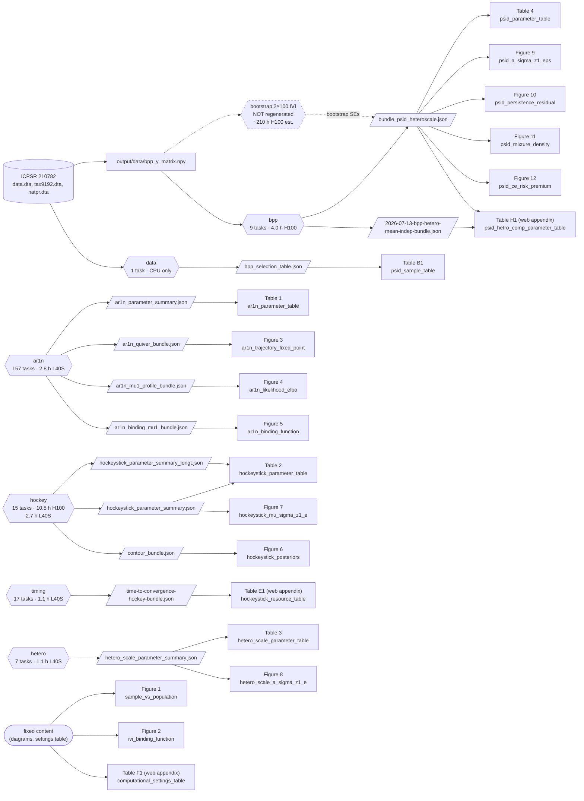

# Replication package: Indirect Variational Inference

[](https://arxiv.org/abs/2607.15168)
[](https://github.com/tlamadon/ivi-replicate/releases/latest)
[](https://colab.research.google.com/github/tlamadon/ivi-replicate/blob/main/notebooks/table2_vi_gaussian.ipynb)

**Contents:**
[Overview](#overview) ·
[Data availability](#data-availability-and-provenance-statements) ·
[Dataset list](#dataset-list) ·
[Computational requirements](#computational-requirements) ·
[Programs](#description-of-programs) ·
[Instructions](#instructions-to-replicators) ·
[Tables and figures](#list-of-tables-figures-and-programs) ·
[References](#references) ·
[File inventory](#appendix-a-file-inventory) ·
[Pipeline management](#appendix-b-pipeline-management)

## Overview

This package reproduces every estimate, figure and table of *Indirect
Variational Inference: Applications to Earnings Dynamics* by Neele Balke,
Stéphane Bonhomme and Thibaut Lamadon (Journal of Labor Economics;
[arXiv:2607.15168](https://arxiv.org/abs/2607.15168)). The code is in Python
(PyTorch for estimation, numpy and Tectonic for figures and tables).

The paper has two parts:

- **Monte Carlo simulations** (Tables 1–3, Figures 1–8, web-appendix Tables
  E1 and F1). These need no external data.
- **An application to PSID earnings** (Table 4, Figures 9–12, Appendix
  Table B1, web-appendix Table H1). It uses the PSID household panel prepared
  by Blundell, Pistaferri and Preston (2008), which replicators download
  themselves from the ICPSR–PSID Data Extract Repository (ICPSR 210782).
  This package contains no PSID data.

The pipeline has three layers, all driven by `replicate.py` (or by the
one-command wrapper `run_all.sh`):

| Layer | What it does | Output | Time |
|---|---|---|---|
| 1: data | Builds the PSID earnings matrix and sample statistics from the ICPSR files | `output/data/` | minutes (CPU) |
| 2: bundles | Runs the estimations and simulations and collects results into JSON *bundles* | `output/bundles/` | ~22 GPU-hours (+ ~210 for the optional bootstrap) |
| 3: figures | Builds every figure and table from the bundles | `output/figures/` | ~2 minutes (CPU) |

The bundles produced by the authors' run are included, so **layer 3 can be
run on its own** in about two minutes, without the data and without a GPU,
to rebuild all figures and tables from the published estimates.

## Data Availability and Provenance Statements

### Statement about rights

- [x] I certify that the author(s) of the manuscript have legitimate access to
  and permission to use the data used in this manuscript.
- [x] I certify that the author(s) of the manuscript have documented permission
  to redistribute/publish the data contained within this replication package.
  The package contains only simulated data, estimation results and aggregate
  sample statistics; it contains no PSID microdata.

### License for data

The results included in this package (`output/`) are licensed under CC BY 4.0;
see `LICENSE`. The PSID-derived input files are not part of the package and
are governed by the ICPSR and PSID terms of use.

### Summary of availability

- [ ] All data **are** publicly available.
- [x] Some data **cannot be made** publicly available.
- [ ] **No data can be made** publicly available.

The simulation results use data generated by the code. The empirical
application uses PSID data that cannot be redistributed, but which any
researcher can obtain free of charge as described below.

### Details on each data source

| Data source | Files | Provided | Access |
|---|---|---|---|
| Blundell, Pistaferri and Preston (2008) PSID extract, ICPSR 210782 V2 | `data.dta`, `tax9192.dta`, `natpr.dta` | No | Free ICPSR account; accept the ICPSR and PSID terms of use |
| Simulated panels | generated by `scripts/_simulation_*.py`, `_time_to_convergence_hockey.py`, `_contour_past_2period_imputed.py` | Regenerated by the code | – |

**PSID data (Blundell, Pistaferri and Preston 2008).** The empirical
application starts from the household-year panel that Blundell, Pistaferri
and Preston (BPP) built from the Panel Study of Income Dynamics (PSID) for
"Consumption Inequality and Partial Insurance" (American Economic Review,
2008). Their replication package is deposited in the ICPSR–PSID Data Extract
Repository as study 210782 (version V2,
[doi:10.3886/E210782V2](https://doi.org/10.3886/E210782V2)). We use three of
its files:

| File | Content |
|---|---|
| `data.dta` | BPP's PSID household-year panel, built by their `create1_AER.do` and `create2_AER.do` from the PSID family files (1968–1992) and the 1968–97 cross-year individual file |
| `tax9192.dta` | TAXSIM federal income taxes for 1991–92 |
| `natpr.dta` | National price index (`cpi`) |

PSID Conditions of Use prohibit redistributing PSID data, so these files and
everything derived from them at the individual level (in particular the
741 × 10 earnings matrix `output/data/bpp_y_matrix.npy`) are not included.
To obtain them:

1. Create a free account at ICPSR and register with the PSID, accepting the
   PSID Conditions of Use.
2. Download the files from
   <https://www.icpsr.umich.edu/sites/psid/view/studies/210782/versions/V2>
   (the data files are in BPP's package; we use only the three above).
3. Place them in `data/raw/` (or set `BPP_EXT` to their directory).
4. Check them against these SHA-256 checksums (`sha256sum data/raw/*.dta`):

```text
c1d1949748e224f03b80803b01ea7775cb043cae1da5e89a8717452591ecfd41  data.dta
0af8a9b32b1b6d3c3d80e2f0830f662bf82c23f1d51a3c27d601f07efb17af81  tax9192.dta
7044d5511d7a3caa079688fe3513043907162373403f7dd53bfeaf1fa2a4cd9b  natpr.dta
```

`scripts/psid_bpp_build.py` ports BPP's
sample selection (`adjust_AER.do`), the PSID part of `impute_AER.do` and the
income definition in `mindist_AER.do` to Python, restricts to 1980–1989 and
the balanced panel, and residualizes log earnings. After layer 1,
`uv run python replicate.py verify-data` checks that the resulting matrix has
the expected SHA-256
(`c9cda89925b3c35ae67ebaac8a3dfb748ac55d76750d609c0879d61555a9ffae`).

Data citations: Blundell, Pistaferri and Preston (2026) for the extract and
Panel Study of Income Dynamics (2026) for the underlying survey; see
[References](#references).

## Dataset list

| File | Source | Notes | Provided |
|---|---|---|---|
| `data/raw/data.dta` | ICPSR 210782 V2 | PSID household-year panel (BPP) | No |
| `data/raw/tax9192.dta` | ICPSR 210782 V2 | TAXSIM taxes 1991–92 | No |
| `data/raw/natpr.dta` | ICPSR 210782 V2 | Price index | No |
| `output/data/bpp_y_matrix.npy` | layer 1 | Residual log earnings, 741 households × 10 years (PSID microdata) | No |
| `output/data/bpp_selection_table.json` | layer 1 | Aggregate sample statistics (counts, means, moments) | Yes |
| `output/bundles/*.json` (11 files) | layer 2 | Estimates, simulation results, bootstrap summaries | Yes |
| `output/bundles/cells/_bpp_hetero_scale_ivi_bootstrap_k40*/bootstrap_theta.json` | layer 2 | Bootstrap replicates of the parameter vector | Yes |

The included files contain parameter estimates and aggregate statistics only.
Each bundle is described in [Appendix A](#estimation-bundles).

## Computational requirements

### Software requirements

- Linux x86-64 (tested on NixOS and RHEL 8). Other platforms are untested.
- [mise](https://mise.jdx.dev), which installs the pinned tools from `mise.toml`:
  - uv 0.12.0 (Python environment manager)
  - Tectonic 0.17.0 (self-contained LaTeX engine for layer 3; downloads about
    50 MB of packages from its versioned TeX bundle on first use)
- Python 3.12, with all packages pinned in `uv.lock` (`requirements.lock` has
  the same pins for pip). The main ones:
  - torch 2.13.0 (with CUDA 13 libraries)
  - numpy 2.5.2, scipy 1.18.1, pandas 3.0.5, statsmodels 0.14.6, matplotlib 3.11.1
  - pydantic, structlog, nvidia-ml-py; pytest for the checks
- Ghostscript ≥ 10, only for the journal EPS files (`gs` on `PATH`).
- No Stata, R, MATLAB or full TeX distribution is needed.

`mise run setup` (or `uv sync --frozen`) creates the environment, about 5 GB.
On NixOS, PyTorch needs `/run/opengl-driver/lib` and 64-bit `libstdc++` and
`libz` on `LD_LIBRARY_PATH`: `nix develop` (from `flake.nix`) supplies the
driver path and `libstdc++`; also make `libz` available, and set
`TRITON_LIBCUDA_PATH=/run/opengl-driver/lib`.

### Controlled randomness

- [x] Random seeds are set at the start of every stochastic program.

Every stochastic entry point calls `mlye.seeding.seed_everything` before any
draw (`tests/test_replication.py` enforces this). It seeds Python, numpy and
torch (CPU and CUDA), turns on `torch.use_deterministic_algorithms`, disables
cuDNN benchmarking and sets `CUBLAS_WORKSPACE_CONFIG`. Each script then uses
explicit seeds, all passed by `replicate.py`, which also sets
`PYTHONHASHSEED=0`:

- simulated panel: `OBS_SEED=11`
- common-random-number draws: `NOISE_SEED=12345`
- encoder initialization: `VI_SEED=11007`; NaN-retry sequence `VI_SEED + i`
- PSID fits: `*_SEED=11`
- bootstrap: household resample seed `31000+b`; the unconditional bootstrap
  also uses `SEED=5000+b` and `NOISE_SEED=900000+b`

Rerunning on the same GPU model, driver and torch build gives bitwise-identical
outputs. Across GPU models (the original runs used H100 and L40S GPUs),
floating-point reduction order differs, so results agree to optimization
precision. `replicate.py compare` quantifies the differences. The wall-clock
times in Table E1 depend on the hardware.

### Memory, runtime and storage requirements

| Stage | Hardware | Time measured in the authors' run |
|---|---|---|
| Layer 1: data | CPU | Minutes |
| Layer 2: estimations and simulations | NVIDIA H100 / L40S GPUs | 22 GPU-hours in total (14.5 h H100, 7.7 h L40S); allow 1–2 days sequentially on one GPU |
| Optional bootstrap (2 × 100 IVI replicates) | NVIDIA H100 | About 210 GPU-hours (estimate) |
| Layer 3: figures and tables | CPU / laptop | About 2 minutes |

- **GPU:** NVIDIA GPU with at least 4 GB of memory and a CUDA 13 compatible
  driver (≥ 580). Measured peak GPU memory was 2.3 GB. Scripts fall back to
  the CPU, but layer 2 is then impractically slow.
- **Memory:** 16 GB of RAM (cluster jobs requested 32 GB).
- **Storage:** about 6 GB (5 GB for the Python environment).
- **Authors' hardware:** the `pythia` Slurm cluster (NVIDIA H100 and L40S
  nodes, RHEL 8) for layers 1–2; a NixOS workstation (NVIDIA RTX 5090) and
  GitHub Actions (`ubuntu-latest`) for layer 3.

The longest task, the T = 40 hockey-stick IVI fit, took 10.5 hours on an
H100. The run summary below is generated from the run's provenance manifests.

<!-- run-summary:begin (generated by `python replicate.py summary --readme`) -->

### Run summary

Measured on the replication run of 2026-10-05 (commit `08c6169`, `759ab56`, 206 tasks with manifests). GPU-hours are task wall-clock time on the GPU type the task actually ran on.

#### Dependency graph



#### Compute by block

| Block | Tasks | GPU-hours | Longest task | Elapsed (first start → last finish) |
|---|---:|---|---|---|
| data | 1 | CPU only | `bpp-sample-stats` (0.0 h) | 0.0 h |
| ar1n | 157 | 2.8 h L40S | `ar1n-sweep-anderson_meanfield_alpha060_m4_ep8000_lr1e-2_crn` (0.2 h) | 1.0 h |
| hetero | 7 | 1.1 h L40S | `hetero-anderson_alpha060_m4_ep16000_lr1e-2_crn_rho030` (0.4 h) | 0.4 h |
| hockey | 15 | 10.5 h H100, 2.7 h L40S | `hockey-t40-picard_cold` (10.5 h) | 10.7 h |
| timing | 17 | 1.1 h L40S | `timing-smc-big-K200` (0.2 h) | 0.6 h |
| bpp | 9 | 4.0 h H100 | `bpp-hs-ivi-it50` (2.9 h) | 3.1 h |
| **total** | **206** | **14.5 h H100, 7.7 h L40S** (= 22 GPU-hours) | | |
| bootstrap (not regenerated) | 200 + 2 | ~210 h H100 (estimate) | | |

The data matrix (`bpp-data`, in the bpp block) and the sample statistics (`data` block) run on a CPU in minutes; so does layer 3 (figures).

#### Bundles and where they are used

| Bundle | Block | Tasks in lineage | GPU-hours in lineage | Used by |
|---|---|---:|---|---|
| `ar1n_parameter_summary.json` | ar1n | 14 | 0.9 h L40S | Table 1 (`ar1n_parameter_table`) |
| `ar1n_mu1_profile_bundle.json` | ar1n | 23 | 0.5 h L40S | Figure 4 (`ar1n_likelihood_elbo`) |
| `ar1n_binding_mu1_bundle.json` | ar1n | 19 | 0.4 h L40S | Figure 5 (`ar1n_binding_function`) |
| `ar1n_quiver_bundle.json` | ar1n | 104 | 1.5 h L40S | Figure 3 (`ar1n_trajectory_fixed_point`) |
| `hetero_scale_parameter_summary.json` | hetero | 7 | 1.1 h L40S | Table 3 (`hetero_scale_parameter_table`), Figure 8 (`hetero_scale_a_sigma_z1_e`) |
| `hockeystick_parameter_summary.json` | hockey | 12 | 2.7 h L40S | Table 2 (`hockeystick_parameter_table`), Figure 7 (`hockeystick_mu_sigma_z1_e`) |
| `hockeystick_parameter_summary_longt.json` | hockey | 2 | 10.5 h H100 | Table 2 (`hockeystick_parameter_table`) |
| `contour_bundle.json` | hockey | 2 | 0.9 h L40S | Figure 6 (`hockeystick_posteriors`) |
| `time-to-convergence-hockey-bundle.json` | timing | 17 | 1.1 h L40S | Table E1 (web appendix) (`hockeystick_resource_table`) |
| `bundle_psid_heteroscale.json` | bpp | 6 | 3.3 h H100 | Table 4 (`psid_parameter_table`), Figure 9 (`psid_a_sigma_z1_eps`), Figure 10 (`psid_persistence_residual`), Figure 11 (`psid_mixture_density`), Figure 12 (`psid_ce_risk_premium`), Table H1 (web appendix) (`psid_hetro_comp_parameter_table`) |
| `2026-07-13-bpp-hetero-mean-indep-bundle.json` | bpp | 5 | 3.7 h H100 | Table H1 (web appendix) (`psid_hetro_comp_parameter_table`) |
| `bpp_selection_table.json` | data | 1 | CPU only | Table B1 (`psid_sample_table`) |

Lineages overlap (e.g. the ar1n Picard cell feeds four bundles), so the per-bundle hours do not add up to the block totals.

#### Figures and tables

| Artifact | Generator | Bundles | Bootstrap |
|---|---|---|---|
| Figure 1 | `scripts/fig_sample_vs_population.py` | fixed content | — |
| Figure 2 | `scripts/fig_ivi_binding_function.py` | fixed content | — |
| Table 1 | `scripts/fig_ar1n_parameter_table.py` | `ar1n_parameter_summary.json` | — |
| Figure 3 | `scripts/fig_ar1n_trajectory_fixed_point.py` | `ar1n_quiver_bundle.json` | — |
| Figure 4 | `scripts/fig_ar1n_likelihood_elbo.py` | `ar1n_mu1_profile_bundle.json` | — |
| Figure 5 | `scripts/fig_ar1n_binding_function.py` | `ar1n_binding_mu1_bundle.json` | — |
| Table 2 | `scripts/fig_hockeystick_parameter_table.py` | `hockeystick_parameter_summary.json`, `hockeystick_parameter_summary_longt.json` | — |
| Figure 7 | `scripts/fig_hockeystick_mu_sigma_z1_e.py` | `hockeystick_parameter_summary.json` | — |
| Figure 6 | `scripts/fig_hockeystick_posteriors.py` | `contour_bundle.json` | — |
| Table E1 (web appendix) | `scripts/fig_hockeystick_resource_table.py` | `time-to-convergence-hockey-bundle.json` | — |
| Table 3 | `scripts/fig_hetero_scale_parameter_table.py` | `hetero_scale_parameter_summary.json` | — |
| Figure 8 | `scripts/fig_hetero_scale_a_sigma_z1_e.py` | `hetero_scale_parameter_summary.json` | — |
| Table 4 | `scripts/fig_psid_parameter_table.py` | `bundle_psid_heteroscale.json` | IVI-row standard errors (100 replicates) |
| Figure 9 | `scripts/fig_psid_a_sigma_z1_eps.py` | `bundle_psid_heteroscale.json` | 95% band around the IVI curves (100 replicates) |
| Figure 10 | `scripts/fig_psid_persistence_residual.py` | `bundle_psid_heteroscale.json` | — |
| Figure 11 | `scripts/fig_psid_mixture_density.py` | `bundle_psid_heteroscale.json` | — |
| Figure 12 | `scripts/fig_psid_ce_risk_premium.py` | `bundle_psid_heteroscale.json` | — |
| Table H1 (web appendix) | `scripts/fig_psid_hetro_comp_parameter_table.py` | `2026-07-13-bpp-hetero-mean-indep-bundle.json`, `bundle_psid_heteroscale.json` | — |
| Table B1 | `scripts/fig_psid_sample_table.py` | `bpp_selection_table.json` | — |
| Table F1 (web appendix) | `scripts/fig_computational_settings_table.py` | fixed content | — |

The bootstrap quantities come from the shipped `output/bundles/cells/_bpp_hetero_scale_ivi_bootstrap_k40_uncond/bootstrap_theta.json` until the bootstrap stage is rerun (`hut.replication_bpp_with_bootstrap.json`).

<!-- run-summary:end -->

## Description of programs

| Path | Purpose |
|---|---|
| `run_all.sh` | One-command replication (layers 1 → 2 → 3, data check, comparison with the published bundles) |
| `replicate.py` | Single source of truth for the pipeline: every task, its layer, settings, seeds, dependencies and resources, and the registry of figures and tables (`FIGURES`) |
| `scripts/psid_bpp_*.py` | Layer 1: PSID earnings matrix and sample statistics |
| `scripts/bpp_*.py` | Layer 2: estimations on the PSID |
| `scripts/_simulation_*.py`, `_time_to_convergence_hockey.py`, `_contour_*.py` | Layer 2: simulation experiments |
| `scripts/_export_*.py`, `*_aggregate.py`, `bpp_hetero_scale_bundle.py` | Layer 2: assemble the bundles |
| `scripts/fig_*.py` | Layer 3: one generator per figure or table, plus compilation (`fig_compile.py`) and EPS export (`fig_eps.py`) |
| `mlye/` | Estimation library: encoders, decoders, priors, the full VI model, SMC and FIVO |
| `tests/` | Consistency checks (pipeline graph, imports, seeding, environment pins, figure registry) |

Every file is listed in [Appendix A](#appendix-a-file-inventory). Code
comments sometimes cite internal design notes (`specs/…`, `journal/…`) from
the authors' development repository; these notes are not part of the package
and are not needed to run it.

### License for code

The code is licensed under the MIT License; see `LICENSE`.

## Instructions to replicators

1. **Install the tools.** On Linux x86-64 with git, install
   [mise](https://mise.jdx.dev), then from the package root run:

   ```bash
   mise install       # uv 0.12.0 and Tectonic 0.17.0
   mise run setup     # Python 3.12 + pinned packages (uv sync --frozen)
   mise run test      # consistency checks, about 1 minute
   ```

   Without mise, install uv and Tectonic yourself and run `uv sync --frozen`
   and `uv run pytest`. Internet access is needed for this step.

2. **Rebuild the figures and tables from the published estimates** (no data,
   no GPU, about 2 minutes):

   ```bash
   ./run_all.sh --figures-only
   ```

   This writes `output/figures/figures.pdf` (all figures and tables, labelled
   with their paper numbers), one PDF and one LaTeX fragment per item, and
   journal EPS files.

3. **Obtain the PSID data** as described in
   [Details on each data source](#details-on-each-data-source) and put the
   three files in `data/raw/`.

4. **Run the full replication:**

   ```bash
   ./run_all.sh                    # layers 1-3, using the published bootstrap
   ./run_all.sh --with-bootstrap   # also rerun the 2 x 100 bootstrap
   ```

   `run_all.sh` builds the data (layer 1), checks the earnings matrix
   checksum, reruns every estimation and simulation (layer 2), rebuilds the
   figures and tables from the new bundles (layer 3), and compares the new
   bundles with the published ones. Regenerating overwrites the files in
   `output/`; `git restore output/` brings back the published versions.

### Details

- **Partial runs.** `uv run python replicate.py run --layer 2 --block hetero`
  runs one block; `--only 'ar1n-sweep-*'` selects tasks by id;
  `--workdir DIR` writes to a separate tree; `uv run python replicate.py list`
  prints every task. The simulation blocks (`ar1n`, `hetero`, `hockey`,
  `timing`) need no data.
- **Bootstrap.** By default, the PSID standard errors and the confidence band
  in Figure 9 use the included bootstrap results
  (`output/bundles/cells/_bpp_hetero_scale_ivi_bootstrap_k40*/`). Add
  `--with-bootstrap` to recompute them.
- **Smoke test.** `uv run python replicate.py run --smoke --layer 1,2
  --workdir /tmp/smoke` runs every task with tiny settings in minutes. It
  checks the code paths, not the results.
- **Colab.** [`notebooks/table2_vi_gaussian.ipynb`](notebooks/table2_vi_gaussian.ipynb)
  reruns one line of Table 2 (the T = 6 unrestricted Gaussian VI fit) on a
  Colab GPU and compares it with the published estimates.
- **Cluster.** The authors ran layers 1–2 on a Slurm cluster through
  [scripthut](https://github.com/tlamadon/scripthut); see
  [Appendix B](#appendix-b-pipeline-management).

## List of tables, figures and programs

The provided code reproduces:

- [ ] All numbers provided in text in the paper (not yet checked against the final text)
- [x] All tables and figures in the paper

Each item is generated by `scripts/fig_<name>.py` into
`output/figures/tex/<name>.tex` (LaTeX fragment), compiled to
`output/figures/pdf/<name>.pdf`; paper items are also exported to
`output/figures/eps/<number>_<name>.eps`. All are collected in
`output/figures/figures.pdf`.

| Figure/Table | Program | Output file (`output/figures/…`) | Input bundle(s) |
|---|---|---|---|
| Figure 1 | `scripts/fig_sample_vs_population.py` | `pdf/sample_vs_population.pdf`, `eps/fig1_sample_vs_population.eps` | fixed content |
| Figure 2 | `scripts/fig_ivi_binding_function.py` | `pdf/ivi_binding_function.pdf`, `eps/fig2_ivi_binding_function.eps` | fixed content |
| Table 1 | `scripts/fig_ar1n_parameter_table.py` | `pdf/ar1n_parameter_table.pdf`, `eps/tab1_ar1n_parameter_table.eps` | `ar1n_parameter_summary.json` |
| Figure 3 | `scripts/fig_ar1n_trajectory_fixed_point.py` | `pdf/ar1n_trajectory_fixed_point.pdf`, `eps/fig3_ar1n_trajectory_fixed_point.eps` | `ar1n_quiver_bundle.json` |
| Figure 4 | `scripts/fig_ar1n_likelihood_elbo.py` | `pdf/ar1n_likelihood_elbo.pdf`, `eps/fig4_ar1n_likelihood_elbo.eps` | `ar1n_mu1_profile_bundle.json` |
| Figure 5 | `scripts/fig_ar1n_binding_function.py` | `pdf/ar1n_binding_function.pdf`, `eps/fig5_ar1n_binding_function.eps` | `ar1n_binding_mu1_bundle.json` |
| Table 2 | `scripts/fig_hockeystick_parameter_table.py` | `pdf/hockeystick_parameter_table.pdf`, `eps/tab2_hockeystick_parameter_table.eps` | `hockeystick_parameter_summary.json`, `hockeystick_parameter_summary_longt.json` |
| Figure 6 | `scripts/fig_hockeystick_posteriors.py` | `pdf/hockeystick_posteriors.pdf`, `eps/fig6_hockeystick_posteriors.eps` | `contour_bundle.json` |
| Figure 7 | `scripts/fig_hockeystick_mu_sigma_z1_e.py` | `pdf/hockeystick_mu_sigma_z1_e.pdf`, `eps/fig7_hockeystick_mu_sigma_z1_e.eps` | `hockeystick_parameter_summary.json` |
| Table 3 | `scripts/fig_hetero_scale_parameter_table.py` | `pdf/hetero_scale_parameter_table.pdf`, `eps/tab3_hetero_scale_parameter_table.eps` | `hetero_scale_parameter_summary.json` |
| Figure 8 | `scripts/fig_hetero_scale_a_sigma_z1_e.py` | `pdf/hetero_scale_a_sigma_z1_e.pdf`, `eps/fig8_hetero_scale_a_sigma_z1_e.eps` | `hetero_scale_parameter_summary.json` |
| Table 4 | `scripts/fig_psid_parameter_table.py` | `pdf/psid_parameter_table.pdf`, `eps/tab4_psid_parameter_table.eps` | `bundle_psid_heteroscale.json` |
| Figure 9 | `scripts/fig_psid_a_sigma_z1_eps.py` | `pdf/psid_a_sigma_z1_eps.pdf`, `eps/fig9_psid_a_sigma_z1_eps.eps` | `bundle_psid_heteroscale.json` |
| Figure 10 | `scripts/fig_psid_persistence_residual.py` | `pdf/psid_persistence_residual.pdf`, `eps/fig10_psid_persistence_residual.eps` | `bundle_psid_heteroscale.json` |
| Figure 11 | `scripts/fig_psid_mixture_density.py` | `pdf/psid_mixture_density.pdf`, `eps/fig11_psid_mixture_density.eps` | `bundle_psid_heteroscale.json` |
| Figure 12 | `scripts/fig_psid_ce_risk_premium.py` | `pdf/psid_ce_risk_premium.pdf`, `eps/fig12_psid_ce_risk_premium.eps` | `bundle_psid_heteroscale.json` |
| Table B1 (appendix) | `scripts/fig_psid_sample_table.py` | `pdf/psid_sample_table.pdf`, `eps/tabB1_psid_sample_table.eps` | `bpp_selection_table.json` |
| Table E1 (web appendix) | `scripts/fig_hockeystick_resource_table.py` | `pdf/hockeystick_resource_table.pdf` | `time-to-convergence-hockey-bundle.json` |
| Table F1 (web appendix) | `scripts/fig_computational_settings_table.py` | `pdf/computational_settings_table.pdf` | fixed content |
| Table H1 (web appendix) | `scripts/fig_psid_hetro_comp_parameter_table.py` | `pdf/psid_hetro_comp_parameter_table.pdf` | `2026-07-13-bpp-hetero-mean-indep-bundle.json`, `bundle_psid_heteroscale.json` |

The bundles are in `output/bundles/`, except `bpp_selection_table.json`
(`output/data/`). The [run summary](#run-summary) traces each bundle back to
the layer-2 tasks that produce it. The PSID standard errors (Table 4) and the
confidence band (Figure 9) use the bootstrap replicates in
`output/bundles/cells/_bpp_hetero_scale_ivi_bootstrap_k40_uncond/bootstrap_theta.json`.

## References

Balke, Neele, Stéphane Bonhomme, and Thibaut Lamadon. 2026. "Replication Data
for: Indirect Variational Inference: Applications to Earnings Dynamics."
Harvard Dataverse. https://doi.org/[DATAVERSE-DOI-PLACEHOLDER].

Blundell, Richard, Luigi Pistaferri, and Ian Preston. 2008. "Consumption
Inequality and Partial Insurance." *American Economic Review* 98 (5):
1887–1921. https://doi.org/10.1257/aer.98.5.1887.

Blundell, Richard, Luigi Pistaferri, and Ian Preston. 2026. "Replication Data
for: Consumption Inequality and Partial Insurance." Version V2. Ann Arbor, MI:
Inter-university Consortium for Political and Social Research [distributor],
ICPSR–PSID Data Extract Repository. https://doi.org/10.3886/E210782V2.

Panel Study of Income Dynamics, public use dataset. Produced and distributed
by the Survey Research Center, Institute for Social Research, University of
Michigan, Ann Arbor, MI ([YEAR-OF-DOWNLOAD-PLACEHOLDER]).

## Appendix A: File inventory

Every file in the package, except the per-figure tables above.

### Top level

| File | Purpose |
|---|---|
| `README.md`, `README.pdf` | This document (Markdown source and PDF) |
| `LICENSE` | MIT (code) and CC BY 4.0 (results, documentation) |
| `run_all.sh` | One-command replication |
| `replicate.py` | Pipeline driver and figure registry |
| `pyproject.toml` | Python project and dependencies |
| `uv.lock` | Pinned Python environment (uv) |
| `requirements.lock` | The same pins for pip |
| `mise.toml` | Pinned tool versions (uv, Tectonic) and shortcut tasks |
| `flake.nix`, `flake.lock` | Nix development shell (NixOS only) |
| `scripthut.yaml` | Cluster environment and backend configuration for scripthut |
| `.github/workflows/release.yml` | GitHub Actions job building layer 3 and attaching `figures.pdf` to a release |
| `.gitignore` | Keeps data, environments and regenerated outputs out of git |
| `data/raw/README.md` | Where to put the ICPSR input files, with checksums |
| `notebooks/table2_vi_gaussian.ipynb` | Colab notebook rerunning one Table 2 estimation |
| `workflows/hut.replication_<block>[_smoke].json` | Generated scripthut workflows for layers 1–2 (12 files: blocks `ar1n`, `hetero`, `hockey`, `timing`, `bpp`, `bpp_with_bootstrap`, each full and smoke); regenerate with `replicate.py hut` |

### Layer 1: data (`scripts/`)

| File | Purpose |
|---|---|
| `psid_bpp_build.py` | Port of BPP's sample selection; builds `output/data/bpp_y_matrix.npy` |
| `psid_bpp_selection_table.py` | Sample statistics: BPP as published vs our selection vs the balanced panel |

### Layer 2: estimation and simulation (`scripts/`)

| File | Purpose |
|---|---|
| `bpp_hetero_scale_vi_mf.py`, `bpp_hetero_scale_vi_jn.py`, `bpp_hetero_scale_vi_sm.py` | VI fits of the heterogeneous-variance model on the PSID (mean-field, joint-normal, structured Markov posteriors) |
| `bpp_hetero_scale_ivi_jn.py` | IVI fit of the heterogeneous-variance model on the PSID; also each bootstrap replicate |
| `bpp_hetero_mean_indep_vi_jn.py`, `bpp_hetero_mean_indep_ivi_jn.py` | VI and IVI fits of the heterogeneous-mean model (Table H1) |
| `_bpp_hetero_scale_ivi_bootstrap_aggregate.py` | Aggregates the bootstrap replicates |
| `bpp_hetero_scale_bundle.py` | Builds `bundle_psid_heteroscale.json` |
| `_export_bpp_hetero_mean_indep_bundle.py` | Builds the heterogeneous-mean bundle |
| `_simulation_ar1n_sweep.py`, `_ar1n_posterior_comparison.py` | AR(1)+normal simulation fits (Table 1) and their model definitions |
| `_simulation_ar1n_mu1_profile.py`, `_simulation_ar1n_binding_mu1.py`, `_simulation_ar1n_quiver.py` | Likelihood/ELBO profile, binding function and quiver (Figures 3–5) |
| `_export_ar1n_parameter_summary.py`, `_export_ar1n_mu1_profile_bundle.py`, `_export_ar1n_binding_mu1_bundle.py`, `_export_ar1n_quiver_bundle.py` | AR(1) bundles |
| `_simulation_hockeystick_ivi_sweep.py`, `_export_hockeystick_parameter_summary.py` | Nonlinear (hockey-stick) model simulations (Table 2, Figure 7) |
| `_contour_past_2period_imputed.py` | Posterior contours (Figure 6) |
| `_time_to_convergence_hockey.py`, `_export_time_to_convergence_hockey_bundle.py`, `gpu_util.py` | VI vs SMC timing experiment (Table E1) and GPU-utilization sampler |
| `_simulation_hetero_scale_ivi_sweep.py`, `_export_hetero_scale_parameter_summary.py` | Heterogeneity-model simulations (Table 3, Figure 8) |
| `_scale_hetero_correlation_sweep.py`, `_scale_hetero_correlation_ivi.py` | Data-generating process and IVI helpers for the heterogeneity simulations |
| `psid_smc_em_fivo_sinhz1.py`, `bpp_hockey_common.py` | Shared model and training helpers for the PSID fits |
| `smc_smoothers.py`, `smc_truth_profile.py`, `climb_per_step.py`, `softplus_sinh_posterior_comparison.py` | Shared SMC smoothers and helpers imported by the experiments |

### Layer 3: figures and tables (`scripts/`)

| File | Purpose |
|---|---|
| `fig_<name>.py` (20 files) | One generator per figure or table; see the table above |
| `fig_compile.py` | Compiles the fragments to PDF with Tectonic |
| `fig_eps.py` | Exports the paper items to EPS (Ghostscript) |
| `fig_preamble.tex` | The paper's LaTeX preamble, shared by all items |
| `fig_parameter_names.md` | Maps parameter symbols in the tables to bundle keys |

### Library (`mlye/`)

| File | Purpose |
|---|---|
| `__init__.py`, `utils.py` | Package entry and utilities |
| `seeding.py` | `seed_everything`, called by every stochastic entry point |
| `models/full_model.py` | Full VI model: encoder, decoder and prior |
| `models/encoders/` (`base.py`, `normal.py`, `markov.py`, `laplace.py`, `layers.py`, `__init__.py`) | Variational posteriors q(z \| y) |
| `models/decoders/` (`base.py`, `ma.py`, `__init__.py`) | Emission distributions p(y \| z), including MA(1) |
| `models/priors/` (`base.py`, `ar.py`, `markov.py`, `utils.py`, `__init__.py`) | Priors: AR(1) and nonlinear Markov |
| `models/__init__.py` | Models package |
| `eval/` (`smc.py`, `fivo.py`, `__init__.py`) | Particle filter and FIVO for likelihood evaluation |

### Tests (`tests/`)

| File | Purpose |
|---|---|
| `test_replication.py` | Pipeline graph, bundle coverage, seeding, environment pins, workflows, figure registry |
| `test_eval_sinh_arcsinh_normal.py` | Unit test of the sinh-arcsinh density |
| `conftest.py`, `__init__.py` | Pytest configuration |

### Estimation bundles

| Bundle (`output/bundles/`) | Block | Contents | Used in |
|---|---|---|---|
| `ar1n_parameter_summary.json` | ar1n | AR(1)+normal simulation: 13 VI / IVI / MLE fits | Table 1 |
| `ar1n_mu1_profile_bundle.json` | ar1n | ELBO/likelihood profile in μ₁ (20-point grid) | Figure 4 |
| `ar1n_binding_mu1_bundle.json` | ar1n | IVI binding function in μ₁ (15-point grid) | Figure 5 |
| `ar1n_quiver_bundle.json` | ar1n | Binding-function quiver on the (μ₁, log σ_ε) plane | Figure 3 |
| `hockeystick_parameter_summary.json` | hockey | Nonlinear model simulation, T = 6 | Table 2, Figure 7 |
| `hockeystick_parameter_summary_longt.json` | hockey | Nonlinear model simulation, T = 40 IVI | Table 2 |
| `contour_bundle.json` | hockey | Imputed-posterior contours | Figure 6 |
| `time-to-convergence-hockey-bundle.json` | timing | VI vs SMC time to convergence | Table E1 |
| `hetero_scale_parameter_summary.json` | hetero | Heterogeneity-model simulation: 6 fits | Table 3, Figure 8 |
| `bundle_psid_heteroscale.json` | bpp | PSID heterogeneous-variance model: VI (3 posteriors), IVI, bootstrap | Table 4, Figures 9–12, Table H1 |
| `2026-07-13-bpp-hetero-mean-indep-bundle.json` | bpp | PSID heterogeneous-mean model vs heterogeneous-variance model | Table H1 |
| `cells/_bpp_hetero_scale_ivi_bootstrap_k40/bootstrap_theta.json` | bpp | Conditional bootstrap (100 replicates) | Table 4 (reference) |
| `cells/_bpp_hetero_scale_ivi_bootstrap_k40_uncond/bootstrap_theta.json` | bpp | Unconditional bootstrap (100 replicates) | Table 4, Figure 9 |
| `output/data/bpp_selection_table.json` | data | PSID sample statistics | Table B1 |

## Appendix B: Pipeline management

### Published outputs and comparisons

The published outputs tracked in git are the 11 estimation bundles
(`output/bundles/*.json`), the sample statistics
(`output/data/bpp_selection_table.json`) and the two bootstrap aggregates
(`output/bundles/cells/_bpp_hetero_scale_ivi_bootstrap_k40*/`). Everything
else under `output/` is git-ignored and can be recreated.

Regeneration overwrites published files in place. Use `git diff output/` to
inspect changes and `uv run python replicate.py compare` to quantify them
against the published bundles at git `HEAD`. To discard regenerated changes
and restore the tracked versions, use `git restore output/`.

### Local execution and smoke tests

Run commands from the repository root. The examples use `uv run python` so
they use the pinned environment; `python` also works after activating it.
Scripts import `mlye` and helpers from source, and `replicate.py` sets
`PYTHONPATH` itself.

```bash
uv run python replicate.py run --layer 2 --block hetero   # one block
uv run python replicate.py run --only 'ar1n-sweep-*'      # task-id globs
uv run python replicate.py run --workdir /scratch/rep1   # write outputs to a separate tree
```

A task is skipped when its outputs already exist, unless an input was
rewritten earlier in the same run. Thus bundles are regenerated whenever
their cells are. Use `--force` to rerun tasks regardless. Logs go to
`output/logs/<task>.log` inside the chosen working directory.

For an end-to-end smoke test (minutes, with the ICPSR files available):

```bash
uv run python replicate.py run --smoke --with-bootstrap --layer 1,2 --workdir /tmp/smoke
```

This runs every layer-1/2 task with tiny epoch counts and grids. It exercises
code paths, file contracts and exporters, but its numbers are not replication
results. Add `--block ar1n,hetero,hockey,timing` to exercise only the simulation
blocks without external data.

### Cluster execution with scripthut

The following uses [scripthut](https://github.com/tlamadon/scripthut) with
the configured pythia Slurm backend. Replace `<source>` with your configured
source name.

Set `MLYE_STACK_ROOT` to an absolute directory on shared storage, with the
same value on every backend using this stack. Configure this outside the
repository, in the remote shell environment used by scripthut's SSH sessions
and inherited by its Slurm jobs:

```bash
export MLYE_STACK_ROOT="/path/to/shared/scripthut-stacks"
```

For example, put the export in the remote account's `~/.bashrc` before any
early return for non-interactive shells. Exporting it only in the local
shell running the scripthut CLI does not configure the remote environment.
Installation and task startup both require it; the Python environment lives
at `$MLYE_STACK_ROOT/mlye-replication/venv`. If you later change the directory,
rerun `scripthut stack install` with `--rebuild` to install it there.

```bash
scripthut stack install mlye-replication --backend mercury-nb --source <source>   # once; pins from uv.lock
# The stack must also be defined in scripthut.yaml on the source's configured branch.
uv run python replicate.py hut          # writes workflows/hut.replication_<block>[_smoke].json (after changing layer-1/2 tasks)
git add workflows && git commit -m "regenerate workflows" && git push
scripthut source sync <source>
scripthut workflow run workflows/hut.replication_ar1n_smoke.json --source <source> --branch replication --backend pythia-nb   # 10-min check
scripthut workflow run workflows/hut.replication_ar1n.json --source <source> --branch replication --backend pythia-nb
# bootstrap: workflows/hut.replication_bpp_with_bootstrap.json instead of workflows/hut.replication_bpp.json
```

The server finds the workflows through the source's `workflows_glob`, a
server-side setting: it must match `workflows/hut.*.json` (for example
`**/hut.*.json`). `scripthut source view <source>` lists the workflow names
exactly as `workflow run` expects them.

Each task runs `python3 replicate.py exec <task-id>` in the server's clone.
Tasks in one run share that clone's `output/`, which is how the aggregate and
export tasks see the per-cell files. Every output and its manifest are also
copied to `$SCRIPTHUT_OUTPUT_DIR`.

For the bpp block, the cluster needs the data. Put the three ICPSR files in
`~/data/bpp_ext/`, or a prebuilt `bpp_y_matrix.npy` in `$MLYE_DATA_DIR` (default
`~/data`). The prebuilt file is used only if its sha256 matches.

### Provenance

Every task writes `output/manifests/<task>.json` with:

- **Code:** git commit and branch, a dirty-tree flag, and the sha256 of the script and of `uv.lock`.
- **Settings:** the exact env and seeds.
- **Hashes:** sha256 and size of every input (upstream outputs, the data matrix, the raw ICPSR files) and every output.
- **Timing:** start and end time and wall clock.
- **Where it ran:** host and Slurm job, partition and node.
- **Runtime, as reported by the script itself:** GPU model, driver, memory and peak use; CUDA, cuDNN, torch and numpy versions; determinism flags.

```bash
uv run python replicate.py collect [--workdir DIR] [--out DIR] [--strict]
```

This writes `output/PROVENANCE.json` (with `--out DIR`, it also copies the
bundles, the layer-3 PDFs and the manifests there; the cluster workflows use
this to ship everything with the run). `PROVENANCE.json` traces each bundle
and each figure through every upstream task. A figure built from a
regenerated bundle chains all the way back through layer 2 to the data; one
built from a published bundle lists that file as an external input with its
hash. For each task it gives the device, wall time and output
hashes. For each bundle it lists the external inputs and the commits used.

It also checks the chain:

- Each input hash a task recorded must equal the output hash recorded by the
  task that produced that file.
- Each output must still hash to what its manifest says.

A file that was already present and not produced in the run is recorded as
`pre-existing`. On the cluster, every workflow ends with a `<block>-collect`
task that ships this to the run's outputs.

Refresh the [run summary](#run-summary) from a run's layer-1/2 manifests with:

```bash
uv run python replicate.py summary --workdir /scratch/rep1 --readme
```

Omit `--workdir` to use the manifests in this repository. This updates only
the generated run-summary block in this README.
